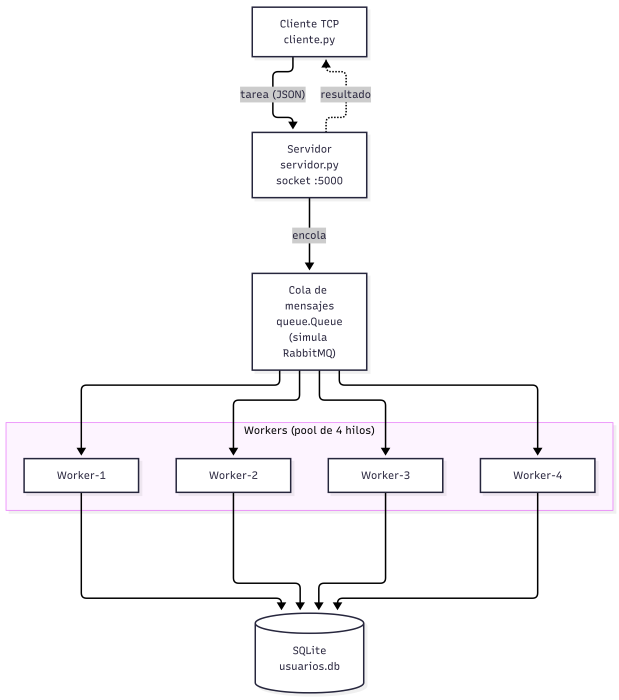
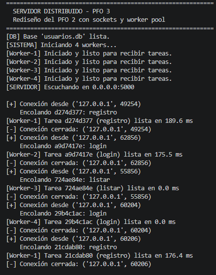
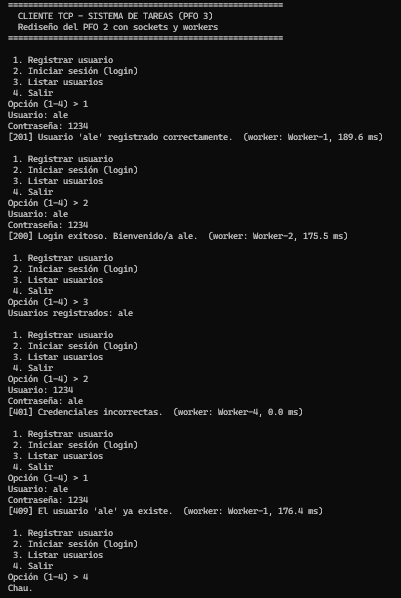

# PFO 3: Rediseño como Sistema Distribuido (Cliente-Servidor)

Trabajo práctico de Programación sobre Redes – IFTS N° 29.
**Alumna:** Alejandra Vazquez

## Objetivo

Transformar el sistema de gestión de tareas del PFO 2 (API Flask + SQLite)
en una arquitectura distribuida usando **sockets TCP** y un **pool de workers**.

## Evolución PFO 2 → PFO 3

- **PFO 2:** API REST con Flask y SQLite. El servidor HTTP procesaba
  registro, login y listado directamente.
- **PFO 3:** Se reemplaza Flask por **socket TCP puro**. El servidor recibe
  el pedido, lo **encola** y un **pool de 4 workers** (hilos) lo procesa con
  la lógica del PFO 2 (hashing con `werkzeug` + SQLite) y devuelve el
  resultado por el mismo socket.
  > **¿Por qué TCP y no UDP?** Porque el sistema necesita garantizar que
> los pedidos de registro/login lleguen completos y en orden (no se puede
> perder un registro de usuario). UDP no garantiza entrega ni orden, así
> que no sirve para este caso.

## Arquitectura

Cliente TCP → Servidor (socket) → Cola → Workers (pool de hilos) → SQLite



### Componentes del diagrama vs. implementación

| Componente del diagrama              | Estado en el código               |
|--------------------------------------|-----------------------------------|
| Clientes (móvil / web / consola)     | `cliente.py` (consola TCP)        |
| Balanceador de carga (Nginx/HAProxy) | Conceptual (no implementado)      |
| Servidor de entrada                  | `servidor.py`                     |
| Cola de mensajes (RabbitMQ)          | `queue.Queue` (simula RabbitMQ)   |
| Workers con pool de hilos            | 4 hilos en `servidor.py`          |
| PostgreSQL / S3                      | SQLite local (misma DB del PFO 2) |

## Sobre la cola de mensajes (RabbitMQ)

El diagrama incluye RabbitMQ como cola de mensajes para comunicación entre
servidores (punto 1 de la consigna). En la implementación (punto 2) se
utiliza `queue.Queue`, una cola de mensajes **en memoria** que cumple la
misma función dentro de un solo proceso: el servidor de entrada encola
las tareas y los workers las consumen.

Esto es una **simplificación** para que la demo sea fácil de correr sin
instalar servicios externos. Para una implementación con RabbitMQ real
se reemplazaría `queue.Queue` por `pika` + un broker RabbitMQ, sin cambiar
la lógica del servidor ni de los workers.

## Archivos

- `servidor.py` → servidor TCP + cola + 4 workers + SQLite
- `cliente.py` → cliente en consola (registro, login, listado)
- `diagrama.png` → diagrama de la arquitectura
- `README.md` → este archivo

## Cómo ejecutar

**Requisitos:** Python 3 y `werkzeug`.

```bash
pip install werkzeug
```

**Terminal 1 – Servidor:**

```bash
python servidor.py
```

**Terminal 2 – Cliente:**
```bash
python cliente.py
```

> **Importante:** para detener el servidor usar `Ctrl + C`, no cerrar la
> ventana con la X (en Windows puede quedar el proceso colgado ocupando
> el puerto 5000).

## Ejemplo de uso
```text
Opción (1-4) > 1
Usuario: ale
Contraseña: 1234
[201] Usuario 'ale' registrado correctamente.  (worker: Worker-1, 189.6 ms)

Opción (1-4) > 2
Usuario: ale
Contraseña: 1234
[200] Login exitoso. Bienvenido/a ale.  (worker: Worker-2, 175.5 ms)

Opción (1-4) > 3
Usuarios registrados: ale

Opción (1-4) > 2
Usuario: ale
Contraseña: mal
[401] Credenciales incorrectas.  (worker: Worker-3, 12.3 ms)

Opción (1-4) > 1
Usuario: ale
Contraseña: 1234
[409] El usuario 'ale' ya existe.  (worker: Worker-4, 8.1 ms)
```

## Códigos de respuesta

| Código | Significado                      |
|--------|----------------------------------|
| 200    | Login exitoso / listado correcto |
| 201    | Usuario registrado               |
| 401    | Credenciales incorrectas         |
| 409    | Usuario ya existe                |
| 500    | Error interno                    |

## Capturas de pantalla

Servidor recibiendo, encolando y procesando tareas



Cliente enviando tareas y recibiendo resultados



